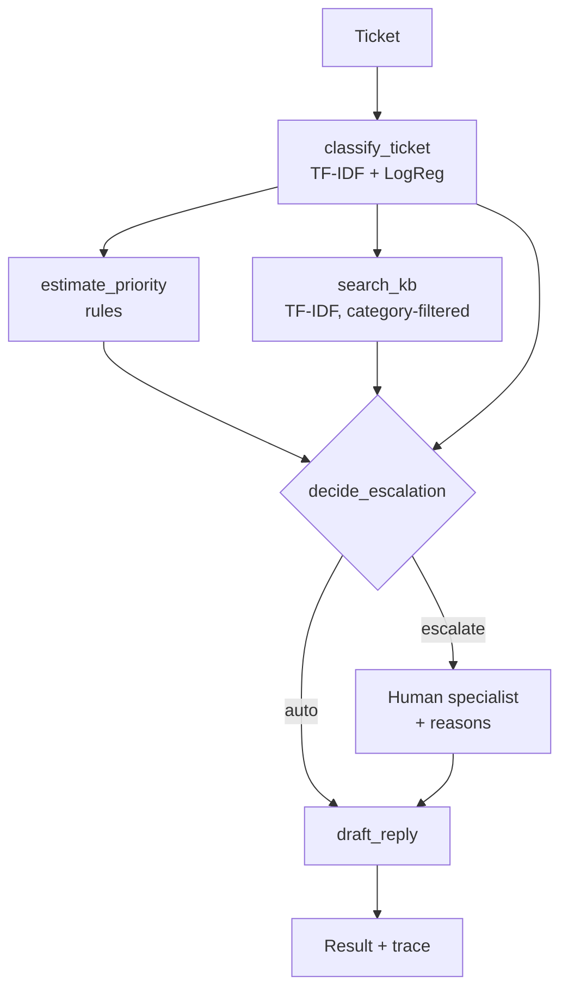

# Ticket Triage Agent

[](https://github.com/Shivanshi-svg/ticket-triage-agent/actions)

A support-ticket triage service that **classifies** an incoming ticket, **assigns a priority**,
**retrieves a knowledge-base article**, **drafts a reply**, and decides whether a **human must take
over**. Every decision is returned with an auditable trace.

> **Data note:** the model is trained on a *synthetic, template-based* ticket generator. No real
> customer data is used.

## Design choices

- **Agent = tools + rules, not a free-running LLM.** For routing, explainability beats creativity.
  Five tools run in a fixed order (`classify_ticket`, `estimate_priority`, `search_kb`,
  `decide_escalation`, `draft_reply`) and each one appends a step to the trace.
- **Safe escalation.** Security tickets always escalate. P1 tickets, low classifier confidence, or a
  missing knowledge-base article also escalate, and the reasons are listed in the response.
- **Pluggable drafting.** `Drafter` is a protocol. The default is a template drafter, and an LLM
  drafter can be added without touching the routing logic.
- **Experiment tracking.** `python -m triage.train --mlflow` logs parameters, metrics and the model
  artifact to MLflow.

## Architecture



## Quick start

```bash
python -m venv .venv && source .venv/bin/activate
pip install -r requirements-dev.txt
pytest -q
python -m triage.train                    # train, print metrics, save artifacts/model.joblib
uvicorn triage.api:app --reload           # http://localhost:8000/docs
```

```bash
curl -s localhost:8000/triage -H 'content-type: application/json' -d '{
  "ticket_id": "T-42",
  "subject": "Suspicious activity",
  "body": "I think someone accessed my account without permission."
}'
```

Docker:

```bash
docker build -t ticket-triage . && docker run -p 8000:8000 ticket-triage
```

To serve a pre-trained model, set `TRIAGE_MODEL_PATH=artifacts/model.joblib`.

### MLflow

```bash
export MLFLOW_TRACKING_URI=sqlite:///mlflow.db
python -m triage.train --mlflow
mlflow ui --backend-store-uri sqlite:///mlflow.db
```

## Honest evaluation notes

The held-out metrics printed by `triage.train` are close to perfect. **Do not read that as real-world
accuracy**: the synthetic tickets come from a small set of templates, so the task is easy. With real
tickets I would expect noisier labels and lower scores, and the confidence threshold (default 0.55)
would need tuning on real data. What the project demonstrates is the engineering around the model:
confidence-aware routing, escalation logic, traceability, tests and tracking.

## Limitations and next steps

- Replace the TF-IDF classifier with a fine-tuned transformer (for example a BERT-family model) and
  compare it against this baseline in MLflow.
- Add an LLM `Drafter` with guardrails (only answer from the retrieved article).
- Persist traces for audit and add human-feedback loops for retraining.

## Layout

```
triage/   data, classifier, kb, agent, api, train
data/     kb.json (knowledge-base articles)
tests/    pytest suite (data/classifier, KB, agent routing, API, training CLI + MLflow)
```
